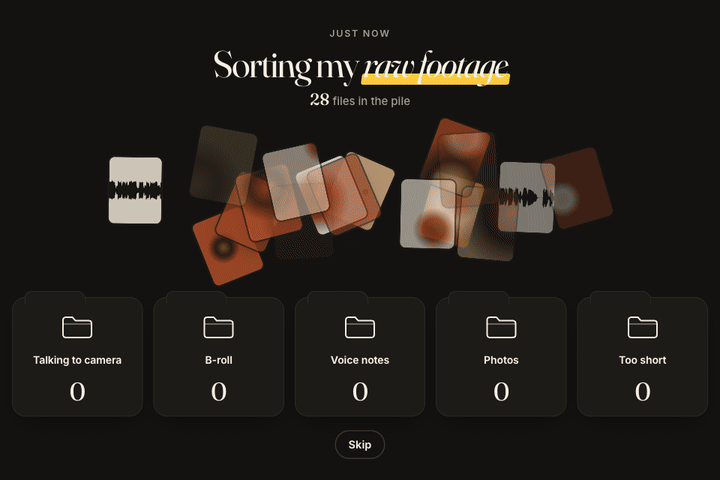
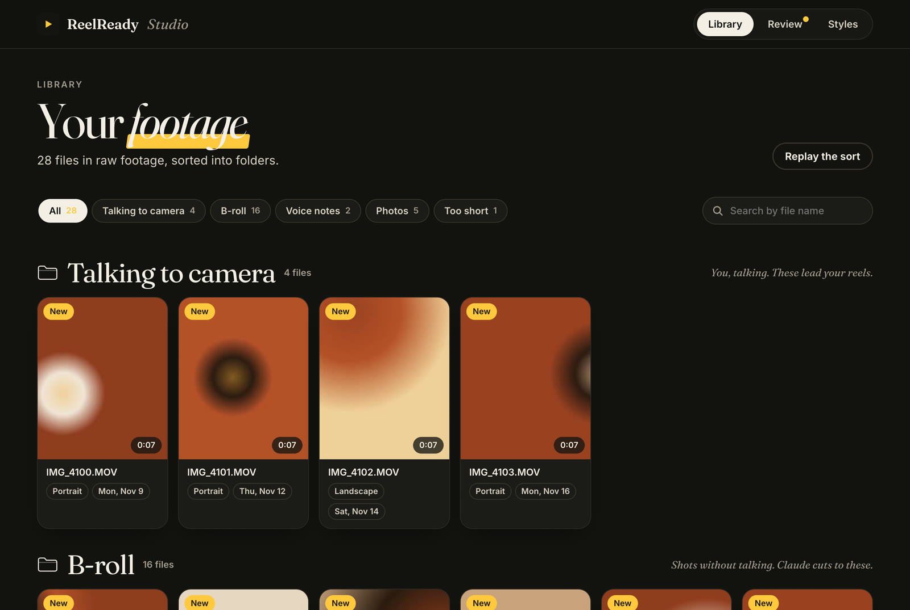
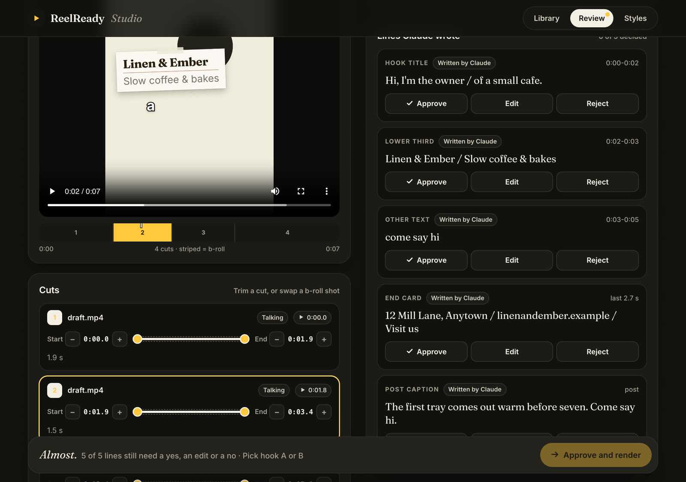
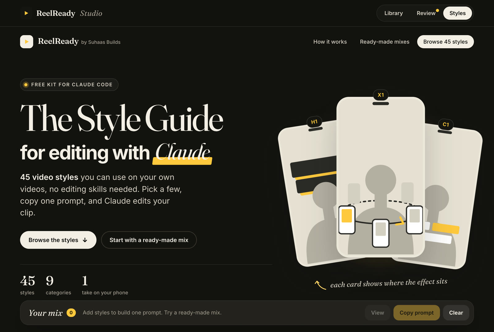
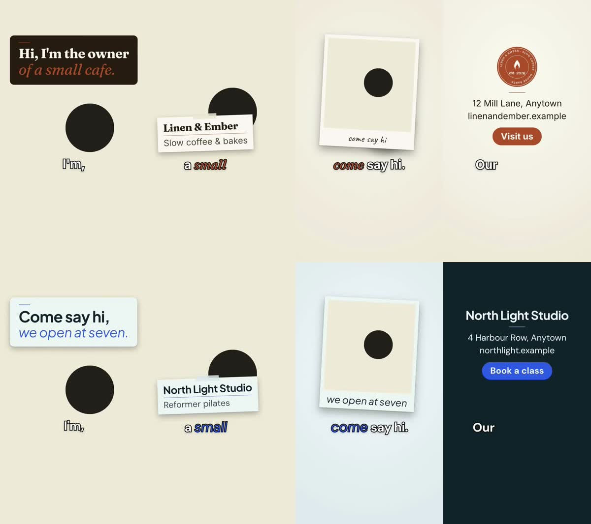

# ReelReady by Suhaas Builds

**Drop a clip. Get a reel.**

ReelReady turns the videos you film on your phone into edited, captioned, on-brand reels, right
on your own computer. It's a free kit for Claude Code: you talk to Claude, Claude does the editing.

- Sorts your clips into folders the moment you open it, and shows them in a Library
- Cuts the pauses, the "um"s and the retakes
- Adds captions that match your words exactly
- Reads your brand from your website and adds your colors, fonts, logo, titles, a lower-third and an end card
- Lets you approve every line it wrote on one Review page before anything renders
- Hands back a 9:16 video ready for Instagram, TikTok or YouTube Shorts
- If you want a script, it asks you a few questions and builds it only from your own answers



## Get started (no tech skills needed)

1. **Download the zip** (green "Code" button -> Download ZIP) and unzip it.
2. **Open Claude Code**: the **Code** tab in the Claude desktop app.
3. **Drag the folder in** and say: **install this**
   Claude installs what's needed, asks you a few easy questions about your brand (name, colors,
   logo, the look you like) and makes an **AI Video Editor** folder on your Desktop.
4. **Drop a clip in `raw footage`** and say: **edit this**
   Claude shows you a quick plan, you say "go", and the finished video appears in `exports`.

That's it. First install takes about 10 minutes (it downloads a free captioning engine once).
You need about **3 GB of free space** on your computer; Claude tells you if it's too full.

## Your folder

```
AI Video Editor/
  raw footage/   <- drop your phone clips here (never changed or deleted; sorted into folders:
                    Talking to camera, B-roll, Voice notes, Photos, Too short. Undo: "undo the sort")
  references/    <- videos you love the look of, or links in links.txt
  assets/        <- logo, fonts/, music/, sfx/
  exports/       <- finished videos appear here
     2026-10-28-latte-art/
        final.mp4     ready to post
        draft.mp4     clean cut, before graphics
        plan.md       the plan you approved
        caption.txt   draft post text (only if you asked; always check it)
```

## Things you can say

| Say | What happens |
|---|---|
| edit this / edit the newest clip | edits the newest video in raw footage (shows you the plan first) |
| edit these 3 clips | talking clip + b-roll shots cut together |
| use styles H1+C2 / use the Cafe story mix | edits with exactly those styles |
| show me the styles | opens the style guide in your browser |
| show me my clips | opens your Library: every clip sorted into folders, with thumbnails |
| undo the sort | puts every sorted clip back where it was |
| write me a script for Saturday | asks you 5 to 8 short questions, then orders your own answers into a script |
| make it 16:9 for YouTube | wide version of the same edit |
| study my references | learns the look of videos you like |
| change my brand colors | updates your setup |

## Zero keys, zero subscriptions

Everything works with **no API keys** and no accounts: your words are turned into captions on your
own computer, and the editing happens there too. Your videos never leave your computer unless you
choose one of the optional cloud upgrades below. (Under the hood: Whisper, ffmpeg, HyperFrames, yt-dlp.)

### Optional upgrades

| Key | What it adds | Where it goes |
|---|---|---|
| AssemblyAI | slightly better transcription on noisy audio | paste it during setup |
| ElevenLabs | alternative cloud transcription (Scribe) | paste it during setup |

Keys are saved privately in `AI Video Editor/.reelready/.env` on your computer. Never in this
folder, never shown back to you.

## The Studio (opens when you start Claude)

One page on your own computer, three tabs. Nothing in it goes online.

**Library.** New clips in raw footage are sorted into folders (Talking to camera, B-roll, Voice notes,
Photos, Too short) and shown with thumbnails, length, shape and the day you shot them. Your files are only
moved into those folders, never renamed or deleted, and "undo the sort" puts them back.



**Review.** Before anything renders, watch the draft, trim a cut, swap a b-roll shot, pick hook A or B, and
approve, edit or reject every line Claude wrote. Press **Approve and render** (or just say "go" in chat).



**Styles.** The style guide: 45 style cards (Hook, Captions, Layout, Proof, B-roll, Signature, Motion & pace,
Outro, Sound), each with a sketch, a short description and a copyable prompt. Mix a few and say
"use styles ...", or say **show me the styles**.



## Your brand, not a template

During setup Claude can read your website for your colors, fonts and logo (you confirm each one), download
your Google Fonts and pick a caption highlight color from your palette. The overlays (hook card, note-card
lower-third, polaroid moment, end card) are drawn from those, so the same clip looks like two different
businesses:



Rules every edit follows: captions are word-for-word, any text Claude writes is marked for your
approval, and only one big effect per moment, so nothing looks "AI".

## Telegram (optional)

Record on your phone, send it to your own Telegram bot, get the edited reel back. Off by default.
See [addons/telegram/README.md](addons/telegram/README.md).

## For developers

- Manual install and troubleshooting: [INSTALL.md](INSTALL.md)
- How it fits together: [docs/architecture.md](docs/architecture.md)
- Agent brief Claude reads: [CLAUDE.md](CLAUDE.md); skills in `.claude/skills/reelready-*`
- Engines (`engines/`, contracts in [engines/README.md](engines/README.md)): `transcribe.py`, `cut.py`,
  `render_cut.py`, `story.py`, `captions.py` (verbatim burn-in, optional per-group emphasis), `overlays.py`
  (brand overlays on HyperFrames), `sound.py`, `qa.py`, `taste.py` (brand gate), `script_check.py`;
  stdlib + a repo-local `.venv`
- Helpers: `scripts/doctor.py` (dependency + free-disk table, exit code), `scripts/setup.sh`
  (idempotent, no sudo), `scripts/init.py --path` (folder contract), `scripts/brand_from_site.py`
  (brand proposal from a website), `scripts/rr.py` (paths, jobs, keys, profile, `fonts`,
  `recommend-accent`, `sort` / `sort --undo`, `studio --start`, `review-request`, `wait-review`)
- Studio: `studio/serve.py` (stdlib server, local only) with `studio/index.html`; the repo's
  `.claude/settings.json` starts it on session start
- Smoke tests: `bash tests/smoke/run.sh` (needs macOS `say`; includes the Studio and script checks) and
  `bash tests/smoke/overlays.sh` (two-brand overlay proof, about 2 minutes, needs the internet once for fonts)
- Rename the brand in one place: `reelready.config.json`
- Style profile schema: [profile/example-profile.json](profile/example-profile.json); the real one
  lives at `<main folder>/.reelready/style-profile.json`
- Bundled third-party skills and their licenses: [.claude/skills/ATTRIBUTION.md](.claude/skills/ATTRIBUTION.md)
  (HyperFrames skills Apache-2.0 with the license text in each folder). Sound effects are synthesised
  by `engines/make_sfx.py`, so they are MIT like the kit: no third-party samples.

Requirements: macOS (Apple Silicon or Intel) with Homebrew is the tested path; Linux best-effort; Windows via a written guide Claude Code follows on your PC (untested so far). See [INSTALL.md](INSTALL.md).

MIT licensed. See [LICENSE](LICENSE).

---

ReelReady is free, and it is built in public on the [Suhaas Builds](https://www.youtube.com/@suhaasbuilds) channel.

Want it set up for you, tuned to your brand, and looked after? That is what [Thrive Labs](https://thrivelabs.ai) does.
